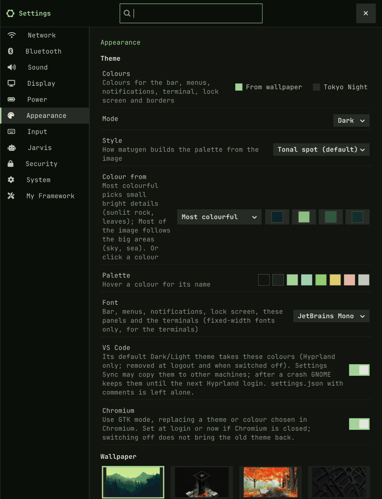
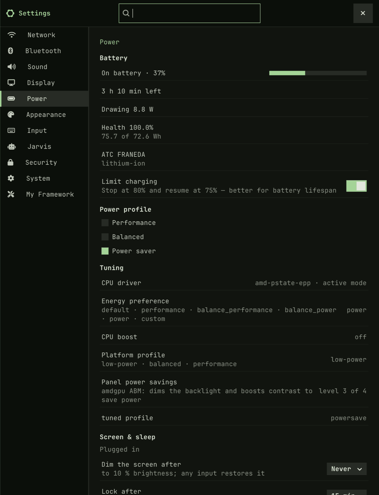
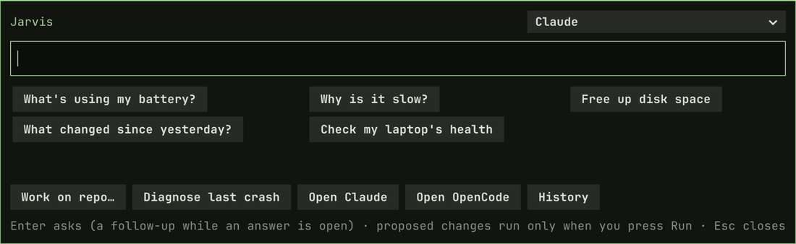
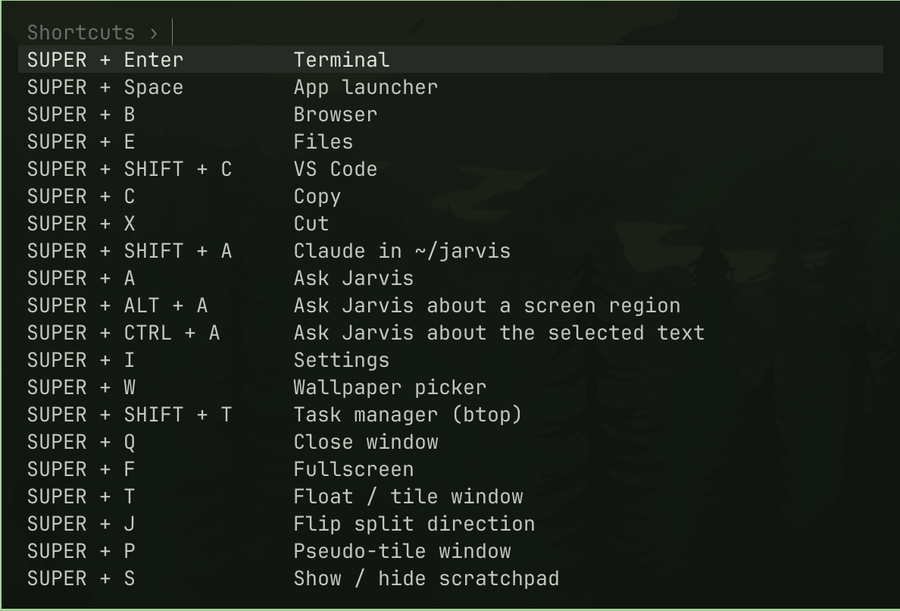
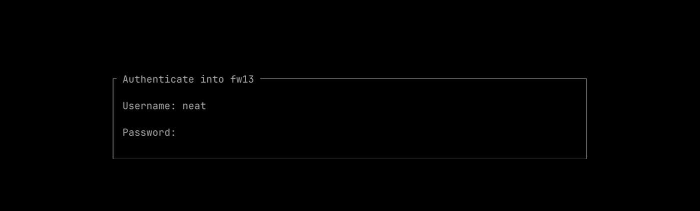

# fw13-hyprland (fw13-hypr)

A Hyprland desktop installer made for one machine: the **Framework Laptop 13 (AMD Ryzen AI 300, tested on the HX 370)** running **Fedora 44 or newer**. It adds a tuned Hyprland session on top of your Fedora install and removes nothing.

## Screenshots

[](docs/screenshots/bar.png)

| Settings → Appearance | Settings → Power |
|---|---|
| [](docs/screenshots/settings-appearance.png) | [](docs/screenshots/settings-power.png) |

| Jarvis (SUPER+A) | Shortcut cheat sheet (SUPER+K) |
|---|---|
| [](docs/screenshots/jarvis.png) | [](docs/screenshots/shortcuts.png) |

[](docs/screenshots/lock.png)

## Supported

| | Status |
|---|---|
| **Framework Laptop 13, AMD Ryzen AI 300** (HX 370 / 365 / 350) | ✅ The target: everything is tested on an HX 370 (Radeon 890M, MediaTek MT7925 Wi-Fi/BT) |
| Framework Laptop 13, AMD Ryzen 7040 | ⚠️ Should work (same EC, `framework_tool` and AMD stack), not tested |
| Framework Laptop 13 Intel, Framework 12/16, other laptops | ❌ Not supported: no Intel tuning, and the Framework-only parts (fan, keyboard backlight, charge limit, fingerprint LED, hardware checks) are hidden or skipped elsewhere |
| **Fedora 44+**: Workstation (GNOME), KDE Plasma, any spin, or Minimal | ✅ GNOME/KDE stay installed and selectable at login |
| Fedora Atomic (Silverblue, Kinoite, …), Fedora 43 or older, other distros | ❌ The installer stops: Atomic can't install packages this way, and Hyprland comes from a COPR that only builds for Fedora 44+ |

## Install

```bash
bash <(curl -fsSL https://raw.githubusercontent.com/NeatOuk/fw13-hyprland/main/install.sh)
```

Or `git clone` the repo and run `./install.sh`. Run it as your normal user; it asks for sudo when it needs it. It's safe to re-run. Reboot when it finishes, then pick **Hyprland (uwsm)** at the login screen.

### Lean install: optional groups

The core desktop (Hyprland, bar, login, fonts, theme, Framework tools, backup, codecs, VPN, kitty, GNOME Files, Chromium, VS Code…) is always installed. These groups are optional; the installer lists them once (all marked by default, Enter keeps them) and remembers the groups you left out in `~/.config/fw13/install-groups-off`, so a group added in a later version is installed by default:

| Group | What it adds |
|---|---|
| `games` | Steam, Lutris, gamescope, MangoHud, GameMode |
| `ai` | Ollama (local models for OpenCode and Jarvis; remote servers work without it) |
| `android` | adb/fastboot + scrcpy phone mirroring |
| `remote` | Remote Desktop Manager (Devolutions repo, ~1.2 GB) |
| `warp` | Cloudflare WARP + the bar's cloud icon |
| `firewall` | Citadel outbound firewall (built from source) |
| `messaging` | Telegram Desktop (official build) |
| `ghostty` | Ghostty terminal (built from the official release) |
| `database` | DBeaver CE database tool (official RPM, ~120 MB) |
| `claude-desktop` | Claude Desktop app (Anthropic's official .deb repackaged as an RPM) + QEMU for its Cowork tab, ~700 MB |
| `localsend` | LocalSend file sharing (Flathub) |

```bash
./install.sh --minimal                   # core only
./install.sh --with=games,ai             # add groups (also to a saved choice)
./install.sh --without=games,warp        # leave groups out
./install.sh --print-plan --minimal      # show the packages and steps, change nothing
```

`--yes` uses your saved choice (or all groups); `--ci` always installs everything. Leaving a group out never removes what's already installed, and never reinstalls it either (also not from **Removed apps**). To remove an app use Settings → Apps → Uninstall… for the apps listed there (Ollama and adb/fastboot included); scrcpy by deleting `/opt/scrcpy`, `/usr/local/bin/scrcpy`, `/usr/local/share/applications/scrcpy.desktop` and `/usr/local/share/man/man1/scrcpy.1`.

## Fresh install on the Framework (Wi-Fi only)

1. Install any Fedora 44+ edition. Connecting Wi-Fi in the installer is enough; the MT7925 card works out of the box.
   - **Minimal Install:** also tick the **"Common NetworkManager Submodules"** add-on, or you'll have no Wi-Fi after reboot.
   - **USB tethering** from your phone works as a fallback, with no drivers needed.
2. Log in and run the one-liner above.
3. Reboot.

What you'll see at each step, and the Framework-only checks to do afterwards: [docs/FIRST-INSTALL.md](docs/FIRST-INSTALL.md).

## What it does

| Step | Detail |
|---|---|
| Repos | RPM Fusion (free + nonfree), COPR `lionheartp/Hyprland` (Hyprland was dropped from Fedora's repos in F43), Microsoft (VS Code), mise, Devolutions (Remote Desktop Manager) |
| Packages | `packages/*.txt`, installed with **optional dependencies off**, so only what's listed (plus hard dependencies) gets installed |
| Login | A clean **text login** (greetd + tuigreet): pick your user, password, and F2 for the session (Hyprland is preselected; GNOME/KDE stay selectable). An existing GDM/SDDM is **disabled, not removed**: run `KEEP_DM=1 ./install.sh` to keep it, or switch back later with `sudo systemctl disable greetd && sudo systemctl enable gdm` |
| Power | Keeps `power-profiles-daemon` if it's installed; otherwise installs `tuned` + `tuned-ppd`. Adds `upower` for battery info and the charge limit. The power profile follows the charger: **Balanced** when plugged in, **Power saver** on battery (a profile you pick by hand lasts until the next plug/unplug) |
| Codecs | Replaces `ffmpeg-free` with RPM Fusion `ffmpeg`, the only package it swaps out |
| Fingerprint | Turns on fingerprint for sudo, login and polkit (`authselect … with-fingerprint`) |
| Dotfiles | chezmoi applies `dotfiles/` to your home folder. It asks once for your Chromium OAuth keys and restic repository, which are never stored in git |
| Tools | mise installs node LTS, chezmoi, starship, uv, kubectl, lazygit and the coding agents OpenCode and Pi; Claude Code comes from Anthropic's native installer (updates itself) |
| Apps | Neovim (LazyVim), EasyEffects speaker sound, Syncthing, Telegram, the Citadel firewall, adb + scrcpy, `framework_tool` and more: see **[docs/APPS.md](docs/APPS.md)** |
| Shell | Lets you pick zsh, fish or bash |
| Extras | Adds the Flathub remote (no apps installed), offers fingerprint enrollment, sets up Timeshift, and checks for firmware updates |
| Report | `~/.local/state/fw13-hypr/install-report.txt`: how many packages it added, their total size, and the largest 25 |

On **Minimal** or another install without GNOME or KDE, the installer warns before it starts and again at the end: Hyprland alone has no file mounting, printing or document viewers, so install GNOME first with `sudo dnf group install workstation-product-environment` (it stays selectable at login). The installer doesn't add it for you.

## Using it

Everything you get after installing: the apps, the Settings app page by page, the bar, Jarvis, backups and the full key list, in **[docs/APPS.md](docs/APPS.md)**. Press SUPER+K on the desktop for the shortcuts.

## Updating

| What | How |
|---|---|
| Everything (packages, dotfiles, tools) | Re-run the one-liner. It pulls the latest repo into `~/.local/share/fw13-hypr` and only adds what's missing (if you cloned the repo yourself: `git pull && ./install.sh`) |
| Fedora + Hyprland packages | `sudo dnf upgrade` |
| Dotfiles only | `chezmoi update` (your `~/.config/hypr/local.lua` is never overwritten) |
| Claude Code | Updates itself; `claude update` to force it |
| BIOS / firmware | `fwupdmgr refresh && fwupdmgr update` |

## Testing

- **CI** (`.github/workflows/test.yml`) runs the real installer in a clean `fedora:44` container on every push and once a week.
  - **It catches** renamed or missing packages, repo problems and script errors, and checks that the key programs and dotfiles ended up in place.
  - **Results:** the install report appears in the job summary.
- **Hardware only:** these can only be checked on the laptop itself: the Hyprland session, Wi-Fi/Bluetooth, fingerprint, suspend, VA-API video decode, the ambient light sensor, and Steam with gamescope.

## Hyprland config (Lua)

Hyprland's config is **Lua** (`~/.config/hypr/hyprland.lua`, which `require()`s `monitors`, `displays`, `looknfeel`, `input`, `windows`, `bindings`, …). The old `.conf` (hyprlang) format is deprecated since Hyprland 0.55 and due to be dropped, so this repo moved early.

- **Your own tweaks** go in `~/.config/hypr/local.lua` (Lua, e.g. `hl.config({ input = { kb_layout = "us,de" } })`). A leftover `local.conf` is no longer read; the installer warns if it had settings.
- **Saved display layouts** from the display panel live in `~/.config/hypr/displays.lua`.
- **Check a config without starting Hyprland:** `Hyprland --verify-config -c ~/.config/hypr/hyprland.lua` (CI runs this too). It catches syntax errors and unknown settings, but not wrong dispatcher arguments.
- **Scripts talk Lua too:** `hyprctl dispatch 'hl.dsp.focus({ workspace = "3" })'`, and `hyprctl eval '<lua>'` replaces `hyprctl keyword`.
- **Log in with "Hyprland (uwsm)"**: without uwsm the desktop portal (file pickers, screen sharing) and other session services don't start, so the installer hides the plain "Hyprland" entry (`/usr/local/share/wayland-sessions/hyprland.desktop`, `NoDisplay=true`). Under uwsm the standard autostart list also runs; `~/.config/autostart` hides nm-applet (and blueman, if still installed) there, since the bar replaces their tray icons.

**Notes / later:**
- Per-screen workspaces are still a Python helper (`fw-workspaces`: a daemon plus one process per SUPER+N). With Lua they could live in the config itself: SUPER+N as a Lua function using `hl.get_active_monitor()`, hotplug via `hl.on(...)` monitor events, the login layout via exec rules. That means no background process and faster keys; it was left as a straight port for now to keep the migration small.
- In Hyprland 0.56.2, `hyprctl binds` reports the SUPER+drag binds without the `mouse` flag, but dragging works.

## Layout

```
install.sh                 entry point (preflight → repos → packages → system files → login/power → user phase → report)
packages/NN-*.txt          one package per line; 15-login and 61-power are conditional
wallpapers/ml4w.txt        default wallpapers to download (sha256 + name; ML4W collection, credited below)
repos/*.repo               vendor repos (vscode, mise, cloudflare-warp, devolutions-rdm)
rpm/                       specs built locally (Telegram Desktop)
system/                    root helpers and config: /usr/local/bin, /etc (systemd, polkit, modprobe, geoclue, Chromium policy)
dotfiles/                  chezmoi source (.chezmoiroot)
```

## Contributing

Start with [CONTRIBUTING.md](CONTRIBUTING.md) (setup, rules, tests, roadmap). Everyone taking part follows the [Code of Conduct](CODE_OF_CONDUCT.md).

## Credits

- **Wallpapers:** the 20 default wallpapers come from the [ML4W Wallpaper Collection](https://github.com/mylinuxforwork/wallpaper) by **Stephan Raabe** ([My Linux For Work](https://github.com/mylinuxforwork), GPL-2.0). They are downloaded from his repository at install time, not stored here. Thank you!
- **Speaker preset:** Framework's FW13 EasyEffects preset from [FrameworkComputer/linux-docs](https://github.com/FrameworkComputer/linux-docs) (GPL-3.0).

## License

GPL-3.0 — see [LICENSE](LICENSE). Packages installed by the script keep their own licenses.
